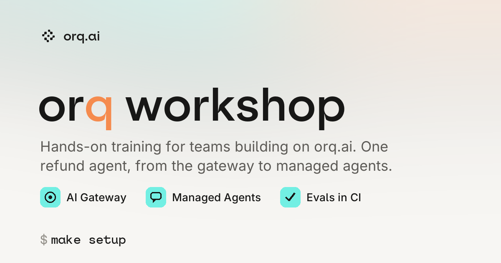
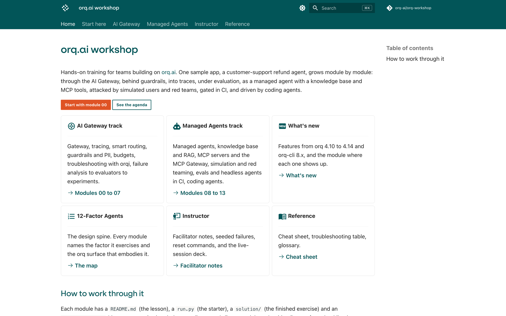

<p align="center">
  
</p>

# orq.ai workshop

Hands-on training for teams building on [orq.ai](https://orq.ai). One sample app, a customer-support refund agent, grows module by module: through the AI Gateway, behind guardrails, into traces, under evaluation, as a managed agent with a knowledge base and MCP tools, attacked by simulated users and red teams, gated in CI, and driven by coding agents.

Docs site: **https://orq-ai.github.io/orq-workshop** · Slides for a live session: `slides/`

<a href="https://orq-ai.github.io/orq-workshop">
  
</a>

## Quickstart

```bash
curl -fsSL https://cli.orq.ai/install.sh | sh     # orq CLI
orq auth login
git clone https://github.com/orq-ai/orq-workshop && cd orq-workshop
orq setup --local --capability gateway            # mints ORQ_API_KEY into ./.env
make setup                                        # uv sync, .env from the example
make orq-doctor && make gateway-check                         # green checks + your first trace
```

Then open `modules/setup/README.md` or the docs site and go module by module. `make seed-workspace` creates every entity a module expects, so you can start anywhere. `make reset-workspace` deletes them all.

## The sections

Setup first, then one section per stage of the loop. `make module M=<name>` runs any module; `make modules` lists them.

| Stage | Modules |
|---|---|
| Start here | Setup · Coding agents · orqi (harnesses, optional) |
| Build | Managed agents · Knowledge base and RAG · MCP servers and gateway · Advisor and sidekick |
| Route and protect | Gateway · Smart routing and routing rules · Guardrails · Budgets and keys |
| Trace | Tracing |
| Find failures | Failure analysis · Trace insights · Annotation queues and automations |
| Evaluate | Evaluators and experiments · Agent simulation · Red teaming |
| Gate and monitor | Evals and agents in CI · Alerts and webhooks |

The core path (setup, gateway, tracing, managed agents, failure analysis, evaluators and experiments, simulation, evals in CI, then a wrap-up on your own repo) takes about four hours with a participant key. The rest are electives.

Every module has a `README.md` (the lesson, with real expected output), a `run.py` (starter with TODOs; the finished file is at the same path on the [`solution` branch](https://github.com/orq-ai/orq-workshop/tree/solution)), an `agent_prompt.md` for the coding-agent path. Each ends with a **Done when** checklist.

**Prefer a notebook?** Check out the `solution` branch (`git checkout solution`), then `make lab` opens JupyterLab with one notebook for every module whose `run.py` is written in Jupytext percent format (`make notebooks` prints the list). Each is the finished module split into steps: a cell of explanation, then a cell that does one thing. The generated files carry no saved output; run a cell to see its result. On `main` the starters are plain scripts, so `make notebooks` finds nothing there.

## Two ways to work

**By hand:** the Python SDK, the OpenAI-compatible gateway, the `orq` CLI, the Studio.

**With your coding agent:** `orq launch claude` (or `opencode`, `pi`, `codex`) routes the agent through the gateway and wires the orq.ai MCP server and the orq.ai skills. Paste the module's `agent_prompt.md`. Both leave the same traces.

## Layout

```text
app/refund_agent/   the sample app (never changes across modules)
app/data/           orders, policy docs, dataset, agent instructions
modules/<name>/     README.md · run.py · agent_prompt.md · assets/ (diagrams) · notebook.ipynb (generated, make notebooks)
evals/              CI regression gate (evaluatorq) and red-team gate
.github/workflows/  evals.yml · nightly-triage.yml · pr-failure-analysis.yml · docs.yml
docs/               MkDocs site (module pages include the module READMEs)
slides/             Marp deck and facilitator guide for a live session
```

## Requirements

Python 3.11 to 3.13, [uv](https://docs.astral.sh/uv/), the orq.ai CLI 12.x, an orq.ai workspace with at least one chat model, one embedding model and one rerank model enabled. Node is only needed for `make slides` if `marp` is not installed.

## License

MIT
