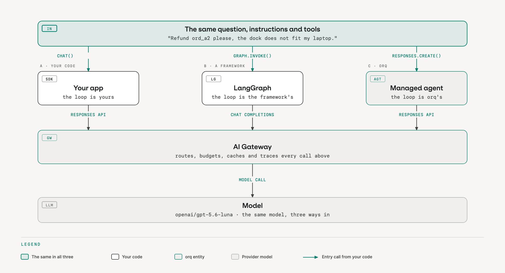

Academy · the idea, no code · <a href="../start/academy/">all six stages</a>

# Build

## The problem

Lumen Goods sells desk lamps, charging docks and small audio gear across the EU and the UK. A customer writes to support: "Refund ord_a2 please, the dock does not fit my laptop." The order is hers, it was delivered twelve days ago, it cost EUR 89 and it has not been refunded before. The policy is clear: inside the 30-day window, under the EUR 500 limit, refund it now and tell her the amount. A support person does this in a minute. The team wants an agent to do it in seconds, and to say no, politely, when the order is above the limit, already refunded, or not hers at all.

The first version was a prompt with the policy pasted in. It handled the happy case and then started improvising. It told one customer the refund was done when no system had moved any money. It decided another order was eligible from memory instead of from the order record. The week the policy text changed, the agent kept quoting the old version. Nothing in that setup separated what the model says from what the business allows.

## The idea

An agent is a model, a set of instructions and a set of tools, run in a loop. The model reads the conversation and either answers or asks for a tool. Something runs the tool and hands the result back. The loop repeats until the model answers or hits a limit on steps or time. For the refund agent one customer turn is at most three rounds: look the order up, read the policy, issue the refund, then the answer.

The split that matters is between deciding and enforcing. The model decides what to say and which tool to call next. The tools decide what is allowed: the lookup returns nothing for an order the customer does not own, and the refund tool refuses a second refund, an amount above the limit, or a date outside the window unless a listed exception applies. The instructions shape likely behavior; the tools enforce the rules. A model that is never allowed to compute eligibility cannot get it wrong.

The second question is who runs the loop. There are three honest answers, and the same refund turn works with all three.

| | Your own loop | A framework | A managed agent |
|---|---|---|---|
| Who owns the control flow | you | the framework | the platform |
| Changing the prompt | edit a file, redeploy | edit a file, redeploy | edit in place, no deploy |
| Where the tools run | your process | your process | your process, or the platform's |
| Choose it when | the control flow is the product | the graph and its ecosystem are worth having | the agent is configuration, not code |

The three are not exclusive, and the tools do not move: a refund tool that touches your order system runs on your side in every shape. What changes is where the instructions, the model choice and the tool schemas live, and whether a prompt change needs a deploy.

Three more pieces attach to the same loop. A knowledge base gives the agent reading material instead of a pasted policy: the policy text is chunked and searched, and the model gets the matching passages, either fetched before the call or fetched by the agent as a tool. An MCP server exposes tools from systems you do not own, behind one trust chain, so the agent can call them without you wiring each one. Delegation lets the agent hand part of a turn to a second model: an advisor sees the transcript and returns advice; a sidekick gets a task and returns a finished artifact.

## What good looks like

- [ ] Every business rule the agent must not break is enforced in a tool, not only stated in the prompt.
- [ ] One customer turn is one call from your application, and the response carries every tool call and result.
- [ ] The prompt, the model and the tool schemas have a version, and you can pin one.
- [ ] Policy text lives in one place that both humans and the agent read, so a policy change is one edit.
- [ ] You can say, for each tool, where it runs and which system it touches.

## Where teams start

Let's assume you have nothing yet: a use case, a policy document and an order system with an API. Write the three tools first, with their refusals, and test them without a model. Then write the instructions as a procedure: look up, read policy, act, explain. Run the loop on five orders you know the answer for before you show it to anyone.

Let's assume you have an agent in production, built on your own loop or on a framework. Keep it. Route its model calls through one gateway so the next five stages apply to it unchanged, and move the rules that live only in the prompt into tools, one at a time. Consider the managed shape only for the parts of the agent that change weekly, such as the instructions.

## On orq.ai

On orq.ai the managed shape is an Agent in the Studio: instructions, model, limits and tools as configuration, with versions you can pin. Tools come in two kinds. A code tool is Python that orq.ai hosts and runs inside the loop, so one Responses API call returns the finished answer with every tool call and result in it. A function tool stops the loop at the call and hands it to your code, which answers it and continues with the previous response id. The refund agent exists as both, and that is how your own order system stays on your side. A knowledge base is a Studio entity the agent can search as a tool, or that the gateway can inject on a plain chat call. MCP servers and MCP gateways register external tools with one bearer key per client. Advisor and sidekick are built-in tool types with their own model and budget, and each delegation shows as its own span in the trace. Start with [Build agents](https://docs.orq.ai/ai-studio/ai-engineering/build-agents).

## Practice it

- [Managed agents](../modules/managed-agents.md) (core path)
- [Knowledge base and RAG](../modules/knowledge-base.md)
- [MCP servers and gateway](../modules/mcp-gateway.md)
- [Advisor and sidekick](../modules/advisor-and-sidekick.md)

## For leaders

**Cost.** A few days for a first agent whose tools already exist; the tools, not the prompt, are the work.

**Risk.** An agent whose rules live only in the prompt will break one of them, and you will hear it from a customer.

**Owner.** The team that owns the business rules owns the tools; the prompt can belong to product.

**Ask your team.** Which decisions does the agent take on its own, and which does it hand to a person?
