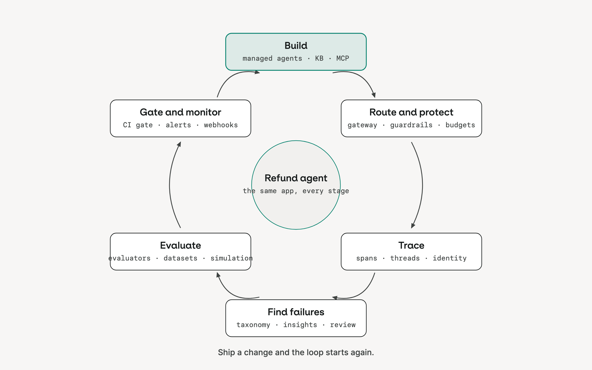

# Academy

The Academy is the concept layer of this site: one page per stage of the loop, no code, about an hour in total. It is written for people who lead a team, own a product, or are new to the topic; the Workshop modules are where engineers practice each stage on orq.ai. Each page ends with a short block for leaders: what the stage costs, what it protects you from, who should own it, and one question to ask your team.

Read them in order the first time. The loop is a cycle: a change shipped at the last stage is what the first stage builds on next.

1. [Build](../build/index.md)
2. [Route and protect](../route/index.md)
3. [Trace](../trace/index.md)
4. [Find failures](../find-failures/index.md)
5. [Evaluate](../evaluate/index.md)
6. [Gate and monitor](../gate/index.md)

## What to ask your team

One question per stage. If the answer is a shrug, that stage is where to invest next.

- **Build:** which decisions does the agent take on its own, and which does it hand to a person?
- **Route and protect:** what happens to a request when the model provider is down, and who pays when a user runs a loop?
- **Trace:** can you show me the full conversation behind one complaint, within a minute?
- **Find failures:** what are the three most common ways the agent fails today, and how do you know?
- **Evaluate:** what runs before a prompt change ships, and what did it catch last month?
- **Gate and monitor:** what blocks a bad change from reaching production, and who gets paged when cost or errors jump?

## If you want to go further

The [core path](core-path.md) is the engineer's version of the same loop: hands-on modules on one sample agent, about four hours. Sit in on one; the "Done when" list at the end of each module is what your team can show you.
