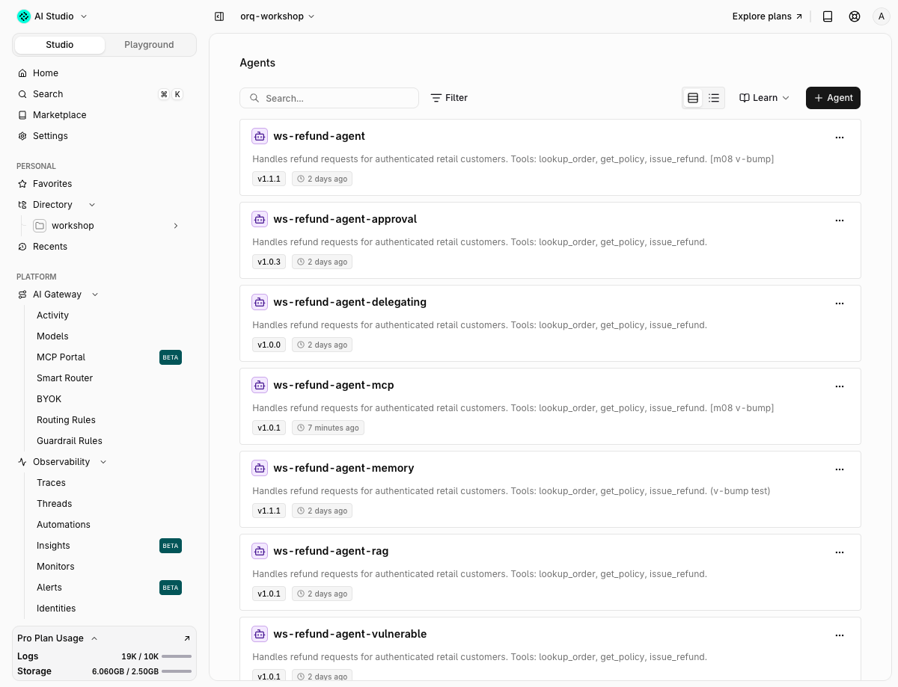

# Managed agents

!!! abstract "The agent and its tools live in orq.ai"
    The agent lives in orq.ai, and so do its three refund tools: they are code tools, small Python functions orq runs for you. One Responses call is one customer turn, eight iterations max. The hybrid alternative, function tools that your own code runs, is step 2b.

| | |
|---|---|
| **Time** | 40 min |
| **Prerequisites** | modules 00 to 02, `make seed` |
| **You will have** | the refund agent invoked through the Responses API from Python, curl and the CLI, with orq running its tools, a function-tool twin whose tools your code runs, streamed, carrying variables and metadata, continued across turns, tool calls steered with `tool_choice`, given memory, versioned and pinned by `@version`. |

Commands and names here write the default prefix `ws-`. Your entities carry your seat prefix from `.env` (`WS_PREFIX`, e.g. `ws07-`), so swap it in before you paste a command.

## Why

Modules 01 to 07 kept the agent loop in [`app/refund_agent/agent.py`](https://github.com/orq-ai/orq-workshop/blob/main/app/refund_agent/agent.py). This module moves the loop to orq.ai: instructions, model, tool schemas, iteration and time limits, knowledge base and memory are one entity with versions. The app shrinks to one Responses call. That is what the Studio, the CLI and the coding-agent skills operate on.

## The one concept to understand first

Who runs the tools? The refund tools are **code tools**: Python registered in orq (`make seed` generates it from [`app/refund_agent/tools.py`](https://github.com/orq-ai/orq-workshop/blob/main/app/refund_agent/tools.py)). When the agent decides to call `lookup_order`, orq runs the code, feeds the result to the model and loops until it has an answer. One call, one finished response:

```python
from orq_ai_sdk import Orq

orq = Orq(api_key=os.environ["ORQ_API_KEY"])          # app/refund_agent/client.py: make_orq()
r = orq.responses.create(model="agent/ws-refund-agent", input="Refund ord_a2 please")
# r.output: function_call (ws-lookup_order), orq:ws-lookup_order (its result), ..., message (the answer)
```

The other option is a **function tool**: orq runs the model, your code runs the tool. The response then stops at a `function_call` item and you continue the chain yourself. That is the hybrid method (step 2b), for tools that must touch your own systems:

```python
r = orq.responses.create(model="agent/ws-refund-agent-function", input="Refund ord_a2 please")
call = r.output[0]                                   # type=function_call, name, arguments, call_id
result = dispatch(store, call.name, json.loads(call.arguments))
r = orq.responses.create(
    model="agent/ws-refund-agent-function",
    previous_response_id=r.id,                       # server-side state, no history resent
    input=[{"type": "function_call_output", "call_id": call.call_id, "output": json.dumps(result)}],
)
```


Match on `call_id`, not `id`. Server-side tools (memory, advisor, `current_date`) also emit a `function_call` item, followed by an `orq:<tool>` item carrying the result; those are not yours to answer. Every call returns `telemetry.trace_id`.

## Steps

Open [`modules/08-managed-agents/run.py`](https://github.com/orq-ai/orq-workshop/blob/main/modules/08-managed-agents/run.py). `run_agent` has one `TODO`, and steps 3 to 8 one each. Step 2b (function tools) is in the solution only. The solution is in `solution/run.py`. The steps follow the [Run Agents](https://docs.orq.ai/ai-studio/ai-engineering/run-agents) docs page: every call is shown in Python, and where it fits, as curl and as the `orq` CLI, all three against the same `POST /v3/router/responses`.

### Step 1 · Inspect the agent

```bash
$ orq agents retrieve ws-refund-agent -o json | jq '{key, version, model: .model.id, settings: {max_iterations: .settings.max_iterations, max_execution_time: .settings.max_execution_time, tool_approval_required: .settings.tool_approval_required, tools: [.settings.tools[] | {action_type, key, requires_approval}]}, knowledge_bases}'
$ make m08      # the solution; the starter prints the same block once its TODOs are filled in
```

Expected output:

```text
── Step 1 · Inspect the agent ─────────────────────────
agent    : ws-refund-agent v1.0.0 (live)
model    : openai/gpt-6-luna
limits   : max_iterations 8, max_execution_time 120s
approval : tool_approval_required=respect_tool
tools    : [('code', 'ws-lookup_order', 'FATJ21'), ('code', 'ws-issue_refund', 'TC5FDV'), ('code', 'ws-get_policy', 'HF132Z'), ('retrieve_knowledge_bases', 'Retrieve Knowledge Bases', '55XZ86'), ('query_knowledge_base', 'Query Knowledge Base', 'X018W4')]  (action_type, key, id suffix: the READ shape)
kb       : [{'knowledge_id': '01M52HK6ZJ0PD67CET6J0VMSAX'}]
memory   : []
patch    : rejected, ValueError: Could not find discriminator field type in {'id': '01M52HK9EHPWJGG12SK…
write    : settings.tools = [{'type': 'code', 'key': 'ws-lookup_order'}, ...]
next     : open Agents > ws-refund-agent in the Studio; the Versions tab is used in step 8
```

Reads and writes have different shapes. A GET returns tools as `{action_type, id, key, requires_approval}`; a create or update wants `{"type": "code", "key": "ws-lookup_order"}`. Inline tool schemas are rejected: register the tool once (`orq tools create`), then reference it by key. The model sees the key as the tool name, which is why the code tools use underscores. Open the agent in the Studio (**Agents** > `ws-refund-agent`): the same instructions, the tool list, the limits, and a **Versions** tab.

### Step 2 · Invoke it: Python SDK, curl, CLI

One question, three clients. The Python SDK:

```python
response = orq.responses.create(model="agent/ws-refund-agent", input="Refund ord_a2 please, the dock does not fit.")
```

curl, the same body:

```bash
$ curl -X POST https://my.orq.ai/v3/router/responses \
  -H "Authorization: Bearer $ORQ_API_KEY" -H "Content-Type: application/json" \
  -d '{"model": "agent/ws-refund-agent", "input": "Refund ord_a2 please, the dock does not fit."}'
```

The CLI:

```bash
$ orq responses create --model agent/ws-refund-agent --input '"Refund ord_a2 please, the dock does not fit."' -o json
```

All three return the same response object: `id`, `status: completed`, `output[]` and `telemetry.trace_id`. Because the tools are code tools, that one response already holds the whole turn: a `function_call` item per tool call, the `orq:<tool>` item with its result, and the final `message`. `run_agent` is a single call that reads the tool names from the output.

```text
── Step 2 · Invoke it ─────────────────────────────────
question : Refund ord_a2 please, the dock does not fit.
tools    : ws-lookup_order → ws-get_policy → ws-issue_refund
requests : 1 in 5.3s, cost $0.00040
answer   : Your refund of €89 has been issued to the original payment method. It should arrive within 5–7 busin…
trace    : 744e2c5fa451cb225ef6898b661d5842
next     : run `orq traces conversation 744e2c5fa451cb225ef6898b661d5842`; the spans show each tool call orq ran
```

`requests : 1` is because the seeded agent uses code tools, so orq runs the whole tool loop inside one request; the function-tool variant in step 2b takes four.

The trace has an `agent.response` span, the `chat` spans of the model and one span per tool call. `orq traces conversation <trace>` renders the conversation as the customer saw it. The code tools start from the same orders on every call, so a refund is not remembered between calls.

If a model confirms the order first and waits ("Would you like to proceed?"), the turn ends with two tool calls and no refund. The fixed instructions say the request is the confirmation; a prompt that asks for one needs a second turn before `issue_refund` shows up.

### Step 2b · Hybrid: function tools your code runs

`ws-refund-agent-function` is the same agent with the three tools registered as function tools (`ws-lookup-order`, ...). orq runs the model, your process runs the tools. The solution's `run_function_agent` is the loop from the diagram above: execute each `function_call` with `tools.dispatch`, send a `function_call_output` keyed on `call_id`, continue with `previous_response_id`, until a message comes back. One request per round, one trace each; the last trace's thread view is the whole conversation.

```text
── Step 2b · Hybrid: function tools your code runs ────
tools    : lookup_order → get_policy → issue_refund  (executed by dispatch() in this process)
requests : 4, one per round of the loop, one trace each
answer   : Your refund of €89 has been issued to the original payment method. It should arrive within 5–7 busin…
next     : run `orq traces conversation cfc4dc136c2cffce5c6c7a7f36c54183`; the last trace renders the whole conversation
```

From curl the continuation is the same two-step cycle:

```bash
$ curl -X POST https://my.orq.ai/v3/router/responses \
  -H "Authorization: Bearer $ORQ_API_KEY" -H "Content-Type: application/json" \
  -d '{"model": "agent/ws-refund-agent-function", "previous_response_id": "resp_...",
       "input": [{"type": "function_call_output", "call_id": "call_...", "output": "{\"ok\": true, \"order\": {...}}"}]}'
```

Pick function tools when the tool must reach something only your code can reach (your database, a private API) or needs your own approval step; pick code tools when the logic can live in orq.

### Step 3 · Stream

`stream=True` returns an event stream; from curl it is `"stream": true` with `-N`. Text arrives as `response.output_text.delta` events; a `function_call` arrives as `response.function_call_arguments.delta` and `.done`, and the complete item on `response.output_item.done`. A prompt the agent answers with a tool call streams no text at all (luna fetches the policy for "what is the refund window?"), so the step asks something the agent answers by itself.

```bash
$ curl -N -X POST https://my.orq.ai/v3/router/responses \
  -H "Authorization: Bearer $ORQ_API_KEY" -H "Content-Type: application/json" \
  -d '{"model": "agent/ws-refund-agent", "input": "Say hello in one sentence.", "stream": true}'
```

| Event | When | Key field |
|---|---|---|
| `response.created` | stream opens | `id`, the `previous_response_id` for the next turn |
| `response.output_text.delta` | each text chunk | `delta` |
| `response.output_text.done` | text complete | `text` |
| `response.output_item.done` | an output item is complete | `item`, the full `function_call` when it is one |
| `response.completed` | agent finished | `response.status` |
| `response.failed` | error | `response.error` |

```text
── Step 3 · Stream ────────────────────────────────────
events   : 17
first    : token at 1.05s
tokens   : ['Hello', '!', ' How', ' can', ' I', ' help']
text     : Hello! How can I help you today?
next     : the first token arrived well before the full text; that is what a chat UI renders
```

The CLI's `--stream` flag does not work in this version: `orq responses create ... --stream` fails with `Not sure how to unmarshal text/event-stream`, so stream with the curl form above. (`orq agents stream` still exists; it speaks the older A2A shape and the SDK marks it deprecated.)

### Step 4 · Variables, metadata, identity, thread

Four request fields that change nothing in the agent and everything in what you can find later. `variables` fill `{{placeholders}}` in the instructions and in the input; the seeded instructions have none, so this step puts one in the input. `metadata` is free-form string pairs, echoed on the response and stored on the trace. `identity` and `thread` are not echoed; they land on the trace as `identity_id` and `thread_id`, which is what groups traces into customers and conversations in the Studio.

```python
tagged = orq.responses.create(
    model="agent/ws-refund-agent",
    input="My name is {{customer_name}}. Greet me by name in one sentence, nothing else.",
    variables={"customer_name": "Jane Okafor"},
    metadata={"session_id": "sess-ws-1", "channel": "chat"},
    identity={"id": "customer-user_001"},
    thread={"id": "conv-ws-1"},
)
```

```bash
$ curl -X POST https://my.orq.ai/v3/router/responses \
  -H "Authorization: Bearer $ORQ_API_KEY" -H "Content-Type: application/json" \
  -d '{"model": "agent/ws-refund-agent",
       "input": "My name is {{customer_name}}. Greet me by name in one sentence, nothing else.",
       "variables": {"customer_name": "Jane Okafor"},
       "metadata": {"session_id": "sess-ws-1", "channel": "chat"},
       "identity": {"id": "customer-user_001"}, "thread": {"id": "conv-ws-1"}}'
$ orq responses create --model agent/ws-refund-agent --input '"My name is {{customer_name}}. Greet me by name in one sentence, nothing else."' \
    --variables customer_name="Jane Okafor" --metadata session_id=sess-ws-1 --metadata channel=chat \
    --identity '{"id": "customer-user_001"}' --thread '{"id": "conv-ws-1"}' -o json
```

```text
── Step 4 · Variables, metadata, identity, thread ─────
answer   : Hello, Jane Okafor!
variables: {'customer_name': 'Jane Okafor'}  (echoed; the placeholder was rendered server-side)
metadata : {'channel': 'chat', 'session_id': 'sess-ws-1'}  (echoed, and stored on the trace)
identity : not echoed; thread: not echoed  (both land on the trace)
trace    : dc72f5ee97761c3ca3776d0e3d565cea
next     : orq traces get dc72f5ee97761c3ca3776d0e3d565cea -o json | jq '.trace | {identity_id, thread_id, metadata: .attributes.metadata}'
```

Metadata values must be strings (a number is a 400). A variable can also be a secret, `{"secret": true, "value": "..."}`: it is passed to platform tools and redacted from traces. To put placeholders in the agent itself, see the Build Agents docs on variables and templates.

### Step 5 · Continue a conversation

`previous_response_id` is not only for tool results. Send it with a new user message and the agent answers with the whole conversation in context, server-side, nothing resent. Any stored response can be fetched again with `orq.responses.get`, and `background=True` returns at once with `status: queued`, so that same `get` doubles as polling.

```python
first = run_agent("ws-refund-agent", "Refund ord_a2 please, the dock does not fit.")
follow_up = orq.responses.create(model="agent/ws-refund-agent", previous_response_id=first["response_id"], input="Thanks. What was the refund amount, digits only?")
fetched = orq.responses.get(response_id=follow_up.id)
queued = orq.responses.create(model="agent/ws-refund-agent", input="Say hello in one sentence.", background=True)   # status: queued
```

```bash
$ curl -X POST https://my.orq.ai/v3/router/responses \
  -H "Authorization: Bearer $ORQ_API_KEY" -H "Content-Type: application/json" \
  -d '{"model": "agent/ws-refund-agent", "previous_response_id": "resp_...", "input": "Thanks. What was the refund amount, digits only?"}'
$ curl https://my.orq.ai/v3/router/responses/resp_... -H "Authorization: Bearer $ORQ_API_KEY"
$ orq responses create --model agent/ws-refund-agent --previous-response-id resp_... --input '"Thanks. What was the refund amount, digits only?"'
$ orq responses get resp_...
```

```text
── Step 5 · Continue a conversation ───────────────────
turn 1   : Your €89 refund has been issued to the original payment method. It should arrive…  (ws-lookup_order → ws-get_policy → ws-issue_refund)
turn 2   : '89'  via previous_response_id=resp_01M52HM0T6TEW9V6MAJHNXZHNE
get      : resp_01M52HM5PHDNM9BKEB9PV07KXC status completed, 1 output item(s), same text: True
background: created with status queued, polled to completed in 2.2s: 'Hello! How can I help you today?'
next     : orq responses get resp_01M52HM5PHDNM9BKEB9PV07KXC -o json | jq '.output[0].content[0].text'
```

`previous_response_id` needs the earlier response stored (`store` defaults to true). A background response that ends in a tool call has no text yet: read `output[].type` before `content`.

### Step 6 · Control tool calls

`tool_choice` steers the agent's own tools: `"none"` forbids them, `"required"` forces at least one, `{"type": "function", "name": "ws-get_policy"}` forces a named one (the tool key). A `tools` array in the request is accepted, echoed and ignored on an `agent/` call: an agent's tools come from its configuration, MCP and HTTP tools included ([MCP servers and gateway](https://orq-ai.github.io/orq-workshop/modules/10/), [Advisor and sidekick](https://orq-ai.github.io/orq-workshop/modules/15/)). Built-in tools (`orq:current_date` in SDK 4.14, `orq:datetime` in the docs) follow the same rule: attach them to the agent.

```python
orq.responses.create(model="agent/ws-refund-agent", input="Refund ord_a2 please, the dock does not fit.", tool_choice="none")
orq.responses.create(model="agent/ws-refund-agent", input="Hello!", tool_choice="required")
orq.responses.create(model="agent/ws-refund-agent", input="Refund ord_a2 please.", tool_choice={"type": "function", "name": "ws-get_policy"})
```

```bash
$ curl -X POST https://my.orq.ai/v3/router/responses \
  -H "Authorization: Bearer $ORQ_API_KEY" -H "Content-Type: application/json" \
  -d '{"model": "agent/ws-refund-agent", "input": "Refund ord_a2 please, the dock does not fit.", "tool_choice": "none"}'
$ orq responses create --model agent/ws-refund-agent --input '"Refund ord_a2 please."' --tool-choice '{"type": "function", "name": "ws-get_policy"}'
```

```text
── Step 6 · Control tool calls ────────────────────────
none     : ['message']
required : ['function_call:ws-get_policy', 'orq:ws-get_policy:ws-get_policy', 'message']
get_policy: ['function_call:ws-get_policy', 'orq:ws-get_policy:ws-get_policy', 'function_call:ws-lookup_order', 'orq:ws-lookup_order:ws-lookup_order', 'function_call:ws-issue_refund', 'orq:ws-issue_refund:ws-issue_refund', 'message']
req tools: ['message']  (get_weather echoed on the response, never called: agent tools are configuration)
next     : `required` on a plain greeting forced a tool the agent did not need; which one varies per run (get_policy or a knowledge tool)
```

With `tool_choice="none"` the agent explains it cannot look the order up: the refusal is the instructions working without tools. `required` on a greeting is the anti-pattern the docs warn about; use it for a retrieval step that must always run.

### Step 7 · Memory

A memory store is an embedding-backed store of documents per `entity_id`. The agent reads and writes it through server-side tools, so it needs three things: the store attached (`memory_stores=["ws_refund_memory"]`), the tools in `settings.tools` (`retrieve_memory_stores`, `query_memory_store`, `write_memory_store`), and instructions that say when to save and when to query. The call then carries `memory={"entity_id": ...}`; from curl it is `"memory": {"entity_id": "..."}`, from the CLI `--memory '{"entity_id": "..."}'`.

```text
── Step 7 · Memory ────────────────────────────────────
created  : memory store ws_refund_memory
created  : agent ws-refund-agent-memory
agent    : ws-refund-agent-memory
entity   : customer-user_001-1792160713
turn 1   : Hi Jane, I’ll keep in mind that you prefer store credit over card refunds.
turn 2   : Hi Jane! You prefer store credit over card refunds.
trace 2  : 6983826fc11e5da254516d90c684851c
next     : open trace 2; expect retrieve_memory_stores and query_memory_store spans, then `orq memory-stores list-memories ws_refund_memory`
```

Two things the solution does deliberately. The store key is `ws_refund_memory`: memory store keys must match `^[A-Za-z]([A-Za-z0-9]*([._][A-Za-z0-9]+)*)?$`, so the `ws-` prefix is not allowed. And the memory goes on a copy, `ws-refund-agent-memory`, not on `ws-refund-agent`: once an agent has memory tools, every call without `memory.entity_id` is a `400 Memory entity ID is required`, which would break every other module that invokes `agent/ws-refund-agent`. The copy is built from the same code tools. Check the store: `orq memory-stores list-memories ws_refund_memory`.

### Step 8 · Versions and `@version` routing

`orq.agents.update(agent_key=, ..., version_increment="minor", version_description="...")` publishes a version. Invoke a pinned version with `agent/<key>@<version>`, an environment with `agent/<key>@<environment>`; no suffix means `latest`.

```text
── Step 8 · Versions and @version routing ─────────────
version  : bumped ws-refund-agent to v1.1.0
call     : agent/ws-refund-agent@1.0.0      ok, trace c4164efea735ad177f2d39be8558aefd
call     : agent/ws-refund-agent@1.1.0      ok, trace eeae2eb23978fc60ca82858b9b7d33c5
call     : agent/ws-refund-agent@latest     ok, trace 59778bff93a1d71c10d6b0307cebb953
call     : agent/ws-refund-agent@production version @production not found for agent ws-refund-agent
next     : assign the production environment in Agents > ws-refund-agent > Versions, rerun, and @production resolves
```

Environments are assigned in the Studio: **Agents** > `ws-refund-agent` > **Versions** > the version's environment menu > `production`. Do it now and re-run: `@production` resolves. The bump changes only the description, so the agent behaves the same; the solution skips it on re-runs.

### Step 9 · The same from the CLI

Every step above has a CLI twin, all on `orq responses create --model agent/<key>`: `--variables k=v`, `--metadata k=v`, `--identity`, `--thread`, `--previous-response-id`, `--tool-choice`, `--memory`, `--background`, and `orq responses get <id>`; streaming is the exception, use curl (step 3). What the CLI adds is the trace search:

```bash
$ orq responses create --model agent/ws-refund-agent --input '"One sentence: what is the refund window?"' -o json | jq '{trace: .telemetry.trace_id, text: .output[0].content[0].text}'
$ orq traces search --from 5m --to now -o json | jq '.data[] | select(.name == "ws-refund-agent") | .trace_id' | head -3
```

## Proof



## With your coding agent

```bash
$ orq launch claude
```

Paste `agent_prompt.md`:

<blockquote class="agent-prompt-frame" markdown>
Use the build-agent skill to create an agent `ws-refund-agent-v2` in path `orq-workshop/workshop` with the same instructions, model and function tools as `ws-refund-agent-function` (tools by key: `ws-lookup-order`, `ws-get-policy`, `ws-issue-refund`), plus the existing function tool `ws-escalate-to-human`. Add one line to the instructions: above the EUR 500 limit, call `escalate_to_human(order_id, reason)` and give the customer the ticket id. Then invoke it through the Responses API with `model="agent/ws-refund-agent-v2"` and input "refund ord_a6", execute the `function_call` items with `app.refund_agent.tools.dispatch` (answer `escalate_to_human` with a fake ticket id), continue with `previous_response_id` until the agent answers, and show me the trace with `orq traces conversation <trace_id>`.
</blockquote>

## Done when

- [ ] `run.py` completes a refund in one request with `tools=['ws-lookup_order', 'ws-get_policy', 'ws-issue_refund']`, and `orq traces conversation <trace>` shows the answer
- [ ] A stream printed its first token before the full answer
- [ ] The step 4 response echoes `variables` and `metadata`, and `orq traces get` shows `identity_id` and `thread_id`
- [ ] Turn 2 answered `89` from `previous_response_id` alone, and `orq responses get` returned the same response
- [ ] `tool_choice="none"` produced a `message` and no `function_call`
- [ ] `orq memory-stores list-memories ws_refund_memory` lists an entity with one document, and turn 2 recalled the name
- [ ] `orq agents retrieve ws-refund-agent -o json | jq .version` is `1.1.0` and `@1.0.0` still answers
- [ ] You can say when a tool should be a code tool and when a function tool, and which output item types a function-tool loop must answer and which it must not

## Gotchas

- `orq agents get` does not exist; it is `orq agents retrieve <key>`.
- Each `responses.create` is a new trace, also with `previous_response_id`. Search by agent name, or pass `thread={"id": ...}` to group them in the thread view.
- `tool_approval_required` and `requires_approval` exist on the agent, but through the Responses API they change nothing: function tools always come back to you (you are the approval), and code tools simply run, and a server-side tool with `requires_approval: true` still ran in our test. See `solution/stretch_factor7.py`.
- The agent's attached knowledge base (`ws-refund-policy`) is rarely searched in these traces; the agent uses `ws-get_policy`. Module 09 covers why, and what retrieval looks like.
- `orq.agents.responses.create(agent_key=, message=, task_id=)` still works but the SDK marks it deprecated, and the docs now list every `/v2/agents` invoke endpoint (`task`, `stream-task`, `run`) as deprecated. Use `orq.responses.create(model="agent/<key>")`.
- `metadata` values must be strings. `identity` and `thread` are not echoed on the response; look for them on the trace.
- SDK 4.14 rejects the built-in tool names the docs use (`orq:datetime`, `orq:web_search`) client-side; it knows `orq:current_date`, `orq:google_search`, `orq:web_scraper`. Either way, attach built-ins to the agent, a request `tools` array is ignored on `agent/` calls.

## New in orq.ai 4.15 and 4.16

MCP servers are their own section in the Agent builder instead of a tool type, and `orq:subagent` and `orq:advisor` are server tools you add to `tools` ([release 4.15](https://docs.orq.ai/changelog/release-4-15)). Every model call in an Agent run records the Agent version that produced it, so automations can target it without custom metadata ([release 4.16](https://docs.orq.ai/changelog/release-4-16)).

## Go further

- Module 15: advisor and sidekick on a copy of this agent, with the nested spans (`advisor` > `chat gpt-5.6-sol`, `sidekick` > `chat gpt-5.4-nano`) and what each costs.
- `solution/stretch_factor7.py`: a human gate in the tool loop plus an `escalate_to_human` tool, on `ws-refund-agent-approval`. Above the limit the agent opens ticket `HR-ord_a6-0001` instead of writing "we will route you".

## Official docs

- [Run agents](https://docs.orq.ai/ai-studio/ai-engineering/run-agents)
- [Responses API](https://docs.orq.ai/ai-gateway/features/responses-api)
- [Memory stores](https://docs.orq.ai/ai-studio/ai-engineering/memory-stores)
- [Advisor and Sidekick](https://docs.orq.ai/ai-studio/cookbooks/common-architecture/advisor-and-sidekick)
- [Build agents](https://docs.orq.ai/ai-studio/ai-engineering/build-agents)
- [Create tools](https://docs.orq.ai/ai-studio/ai-engineering/create-tools)
- [Create response API](https://docs.orq.ai/reference/responses/create-response)
