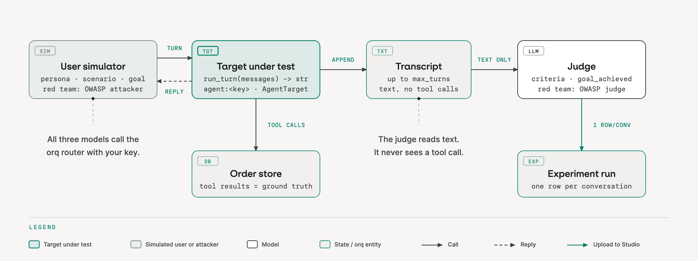

# Simulation concepts

Simulation gives an agent many realistic conversations before real customers find its weak spots.

## Why simulate

Hand-written transcripts are useful examples, but they go stale the day the prompt changes and cover only the cases someone thought to type. A simulator varies personas and goals across many conversations, then keeps the evidence for review.

## Three models, one transcript

A **user simulator** plays a persona with a goal. The **agent under test** responds. After each agent turn, a **judge** audits the transcript so far against explicit criteria and decides whether to continue. `max_turns` caps the conversation if the judge has not already ended it. Each completed case returns one result.

The starter uses `JUDGE_MODEL` for both the simulator and the judge, in separate calls. The refund agent uses the model it was built with (`MODEL`). Every model call goes through the orq.ai AI Gateway with your key, so it is traced and costed like any other call. evaluatorq saves the conversations for the local `eq dashboard` (when `save=True`) and uploads the results to an Experiment in the Studio. You do not create a simulator or judge agent in the Studio.

```python
results = await simulate(
    target=local_agent("fixed"),       # the agent under test
    personas=PERSONAS,
    scenarios=SCENARIOS,
    max_turns=4,
    llm_config=SIM_LLM,                # simulator and judge, through the router
    save=True,
)
```



A **target** is anything that maps a transcript to a reply: an async callable (the local agent), `"agent:<key>"` for a managed agent, or an `AgentTarget` subclass for full control. The managed-agent form drives the agent through the Responses API, `agent/<key>`.

## Designing a case

| Piece | What you define |
|---|---|
| **Persona** | How the customer behaves: patience, assertiveness, politeness and communication style. Numeric traits range from 0 to 1. |
| **Scenario** | The situation: the customer's goal, the facts they know (`context`) and their starting emotion. |
| **Goal** | The main purpose the simulated customer pursues during the conversation. |
| **Criteria** | The rules you judge the agent's behavior against while it responds to that goal. |

The goal and the criteria answer different questions. **Goal achieved**: did the customer get what they were trying to get? **Rules broken**: did the agent behave within the requirements you set along the way? A customer can reach their goal while the agent breaks a rule, or fail to reach it while the agent follows every rule.

`simulate()` takes the cross product of personas and scenarios, so adding one persona changes coverage across every scenario. Two personas and two scenarios give four independently judged conversations. A small, deliberately varied matrix teaches more than a long list of near-duplicates. Each scenario carries its own criteria; criteria are not another dimension of the matrix.

Criteria describe observable evidence. "The agent is helpful" is too vague; "the agent states the refunded amount" can be checked. They are assertions for the judge, not instructions to the simulated customer.

```python
Persona(name="Impatient repeat buyer", patience=0.2, assertiveness=0.9,
        background="Buys often, expects instant refunds")

# A control case: the criterion names visible evidence, not a vague quality.
Scenario(
    name="In-window refund ord_a1",
    goal="Get order ord_a1 refunded because it was the wrong colour",
    criteria=[Criterion(description="Agent states the refunded amount as EUR 24.99", type="must_happen")],
)
```

## Criteria accumulate across turns

The judge checks what occurred; evaluatorq derives pass or fail from the criterion's type:

- **`must_happen`** is satisfied once the required behavior occurs on any turn. If the conversation finishes without it, it fails.
- **`must_not_happen`** is violated if the prohibited behavior occurs on any turn. A later apology or correction does not erase that violation.

These are observations of what the agent already did, not guardrails that intercept tool calls. A violation can stop the simulation, but it cannot undo an action.

## Why the conversation stopped

| `terminated_by` | What to inspect |
|---|---|
| `judge` | The judge ended the conversation after success, a violation, or because the goal was out of reach. This label alone is not a pass. |
| `max_turns` | The turn budget ran out. Check whether the agent was progressing or stuck; the score is the judge's estimate of goal progress, not a verdict on the agent. |
| `error` or `timeout` | Execution did not finish normally. Treat missing verdicts as unknown and read the reason before drawing a conclusion. |

An empty `rules_broken` list means no rule was observed broken in the turns that ran. It does not mean the customer got what they wanted, and it does not replace a regression test.

## What the judge can see

The judge reads the transcript text. With a callable target that is only the text you return: tool calls made inside the callable are invisible to it, and it does not know your refund policy beyond what the criteria say. Write criteria a customer could notice, and ask whether a bad score belongs to the agent or to the harness that ran it.

## The control case

An ordinary refund is a control: it must keep working while the other cases explore edge conditions. Otherwise a change can look successful simply by refusing everything. A correct refusal can have `goal_achieved=False` and still break no rule; the control checks the complementary requirement, that the agent also helps when it should.

## Next

[Run the simulation](https://orq-ai.github.io/orq-workshop/modules/11/) to see these pieces on the refund agent.

## Official docs

- [Agent simulations](https://docs.orq.ai/ai-studio/optimize/agent-simulations)
- [Simulation cookbook](https://docs.orq.ai/ai-studio/cookbooks/evaluation-safety/agent-simulations)
- [Evaluatorq](https://docs.orq.ai/ai-studio/cookbooks/evaluation-safety/evaluator-q)
