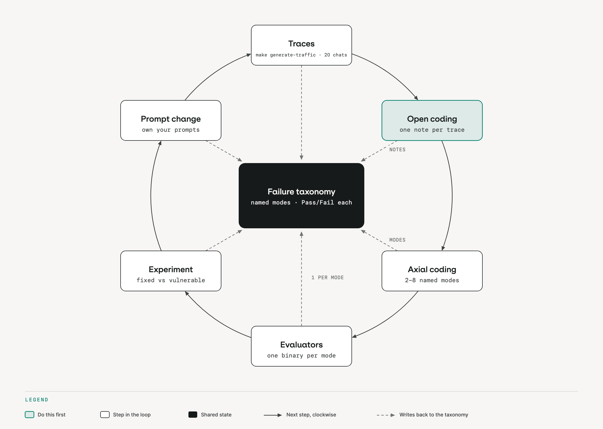

# Concepts

A prompt change is a hypothesis; repeatable evaluation is the evidence that it helped.

## Error analysis before evaluators

Start with transcripts. Write one short observation per conversation (open coding), then group the observations into two to eight named modes (axial coding). Those modes form a failure taxonomy, and each one gets a focused binary scorer. A scorer written before that reading measures the failures you imagined, not the ones you have.

```python
# evals/scorers.py: one scorer, one binary question
async def decision_matches(params):
    output = _out(params)
    expected_refund = params["data"].inputs.get("expected_decision") == "refund"
    refund_called = "issue_refund" in (output.get("tool_calls") or [])
    passed = refund_called == expected_refund
    return EvaluationResult(value=passed, pass_=passed, explanation=...)
```



## Scorers: code or judge

Use code for checkable facts: `decision_matches` (was `issue_refund` called if and only if the row expects a refund) and `no_pii_leak` (a regular expression over the answer). Use an LLM judge for contextual policy following: `policy_judge` calls the orq.ai evaluator `ws-refund-policy-judge`, which reads the customer message, the agent answer and the row's reference.

Each kind has a blind spot. `decision_matches` reads which tools were called, not what they answered. The judge reads the answer text, not the tool calls. Run both, and read the per-row explanations when they disagree.

## A gate, not a demo

A fixed set of dataset rows runs through the agent. The scorer means are compared with calibrated thresholds, producing a pass or fail and an Experiment record. The policy judge gets a margin rather than an impossible demand for certainty, because an LLM judge lands on the threshold often enough that a zero-margin gate flakes on a correct change.

```python
# evals/regression.py
THRESHOLDS = {"decision_matches": 0.80, "no_pii_leak": 1.00, "policy_judge": 0.70}
failed = [scorer for scorer, threshold in THRESHOLDS.items()
          if scores.get(scorer, 0.0) < threshold]
return 1 if failed else 0
```

The evaluatorq call has three deliberately separate layers: **data** supplies rows (`app/data/dataset.jsonl`), a **job** runs the agent on one row and returns a stable output (`answer`, `tool_calls`, `trace_id`), and **evaluators** score that output. You can replace the agent, the rows or a scorer without rewriting the other two. [Evals and agents in CI](https://orq-ai.github.io/orq-workshop/modules/evals-in-ci/) wires the same command into a pull request.

## Simulation versus regression eval

| Method | Purpose | Output |
|---|---|---|
| Simulation | Explores unfamiliar conversations and finds failures | transcripts and evidence |
| Regression eval | Pins known cases and catches their return | scorer means and a gate verdict |

A conversation that went wrong becomes a dataset row once it is understood well enough to state the expected behavior.

## Soft fix, hard proof

A prompt fix lowers the odds of a bad choice; it does not make one impossible. The regression eval checks the relevant cases on every version. To go further, harden the tools (the refund tool already enforces ownership, the EUR 500 limit and the 30-day window) and keep personal data out of the answer.

The general takeaway is a hierarchy of controls: prompts shape likely behavior, tools enforce deterministic policy, and evaluators independently measure both the answer and the action trail. Do not ask one layer to prove itself.

## Official docs

- [Build agents](https://docs.orq.ai/ai-studio/ai-engineering/build-agents)
- [Datasets](https://docs.orq.ai/ai-studio/optimize/datasets)
- [Evaluators](https://docs.orq.ai/ai-studio/optimize/evaluators)
- [Experiments](https://docs.orq.ai/ai-studio/optimize/experiments)
- [Evaluatorq](https://docs.orq.ai/ai-studio/cookbooks/evaluation-safety/evaluator-q)
