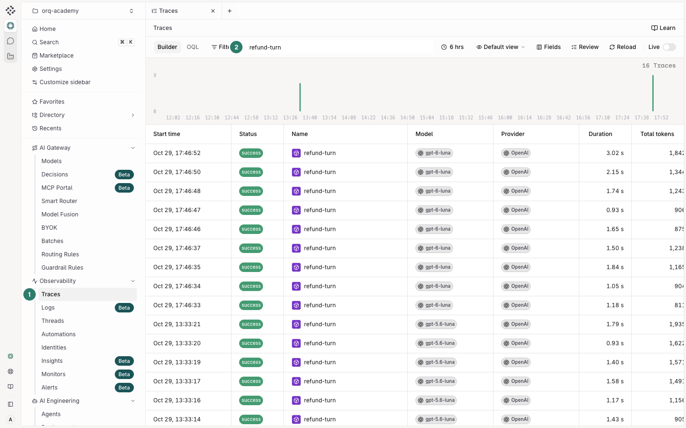
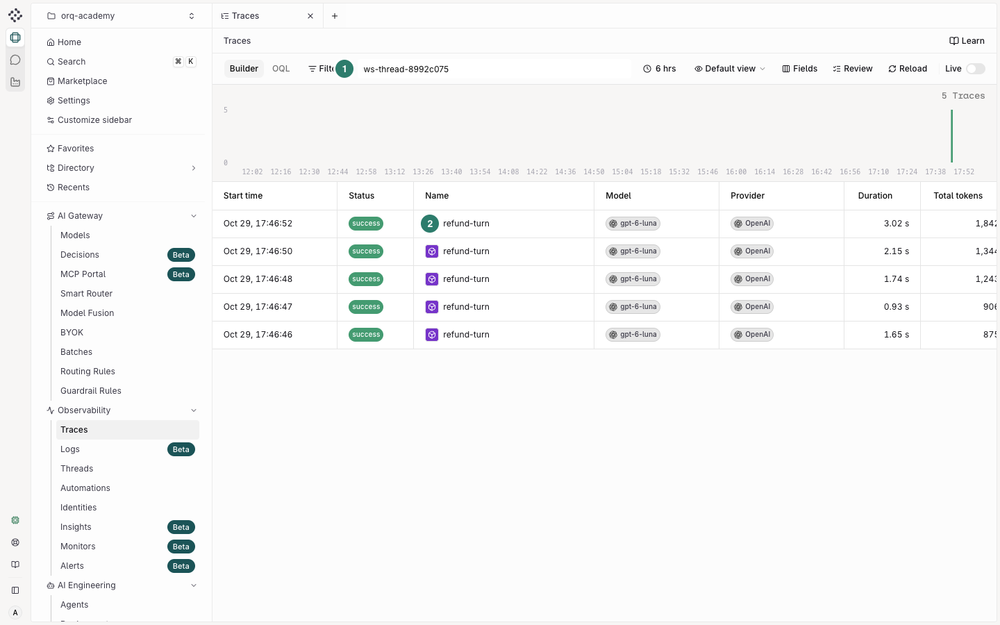
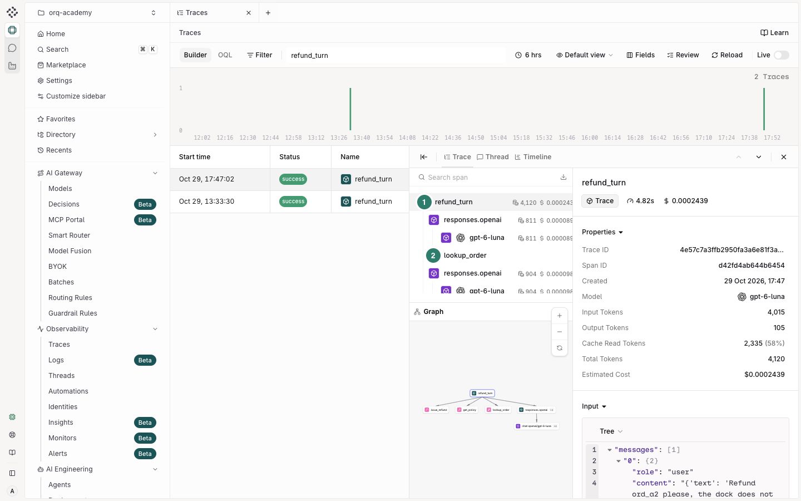
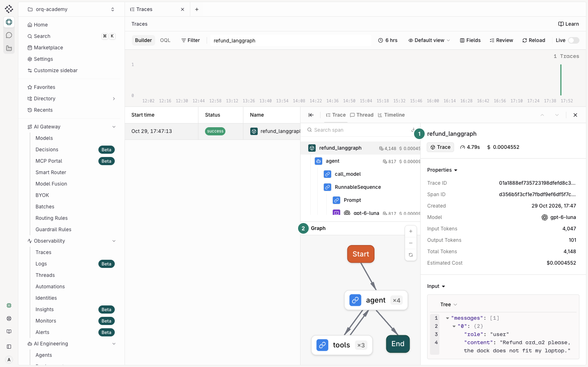
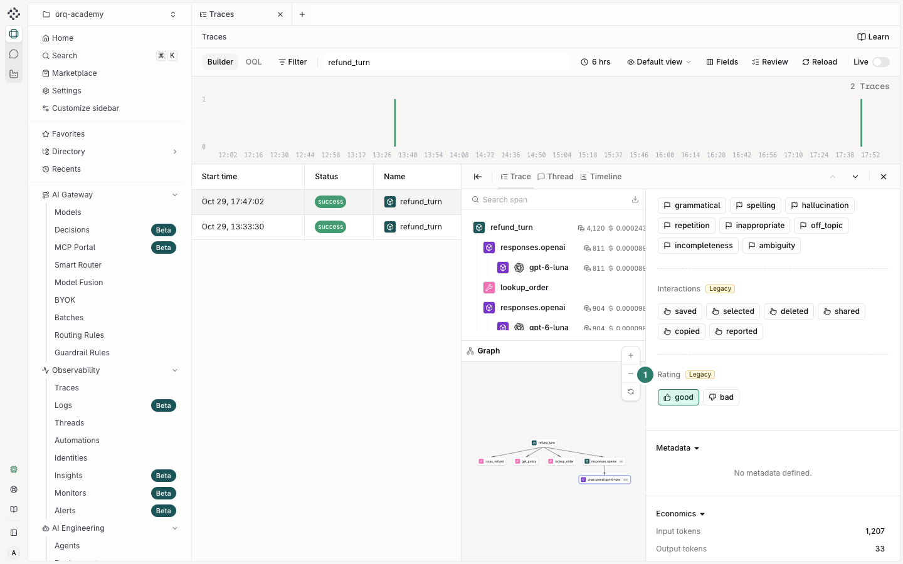

# Tracing

!!! abstract "The context window, readable after the fact"
    The trace is the context window you can read after the fact: every model call, every tool result, in order. Identity, thread and metadata ride on the same request, so who asked, in which conversation, on which plan, is on the trace and not in a side table.

## Starting point

Done: [Gateway](https://orq-ai.github.io/orq-workshop/modules/gateway/).
Command: `make module M=gateway`. Time: 30 min.

## Goal

Traces you can search by customer and conversation, one trace that reads `refund_turn -> tool -> llm`, a framework traced over OpenTelemetry, and one human rating on an answer. Five steps, one changed line each.

## Why this matters

The gateway module left traces behind without a line of code. This module makes them yours: named, grouped per customer and conversation, with your own agent loop and tools in the same tree. Every later module (failure analysis, evaluators, red teaming) starts from these traces.

!!! tip "Why traces, without the code"
    [Academy › Trace](https://orq-ai.github.io/orq-workshop/academy/trace/), 8 minutes: logs versus traces, stepped through on one customer complaint, and the four ways to get traces into orq.ai.

## How it works

Three things decide what a trace looks like, and all three are in your hands:

1. **Request fields.** On `/v3/router/responses` (and on `/chat/completions`), `name`, `identity`, `thread` and `metadata` are top-level fields of the request body. The OpenAI SDK forwards them through `extra_body`. They become filters in the Studio and in `orq.traces.search` ([request metadata](https://docs.orq.ai/ai-gateway/request-metadata), [thread management](https://docs.orq.ai/ai-gateway/thread-management)).
2. **The W3C `traceparent` header.** When a gateway call carries it, the gateway continues your trace instead of starting its own. `run_turn` adds it from the active `@traced` span (via `orq_ai_sdk.traced.propagation_headers()`).
3. **Spans you add.** `@traced(type="agent")` and `@traced(type="tool")` from the orq.ai SDK add the steps the gateway cannot see; a framework such as LangGraph adds them for you over OpenTelemetry. Both export over OTLP to `https://my.orq.ai/v2/otel`.


## Steps

Open [`modules/tracing/run.py`](https://github.com/orq-ai/orq-workshop/blob/main/modules/tracing/run.py). Each step is a function with one line marked `# CHANGE:`; the script runs as is and tells you, step by step, which line is still unchanged. Run it after each change:

```bash
$ uv run python modules/tracing/run.py
```

The finished file is at the same path on the [`solution` branch](https://github.com/orq-ai/orq-workshop/tree/solution).

### Step 1 · Name the traces you already have

!!! example "Change · Run · Watch"
    - **Change** `trace_name = None` → `trace_name = "refund-turn"` in `step_1_name`.
    - **Run** the script.
    - **Watch** the newest traces in the list: named `refund-turn` instead of after the endpoint.
    - **Why it matters** a name is the first filter anyone uses: "show me the refund turns of the last hour".

=== "Studio"

    

    1. Open **Observability › Traces**. The newest rows are this run's model calls, each with duration and tokens.
    2. Type `refund-turn` in the search box. Before the change nothing matches; after it, this run's calls are there.

=== "Code"

    ```python
    trace_name = None  # CHANGE: "refund-turn"
    result = chat(QUESTION, extra_body={"name": trace_name} if trace_name else None)
    ```

    `name` is a top-level field of the request body; `extra_body` is how the OpenAI client sends it.

=== "CLI"

    ```bash
    $ orq traces search --from now-10m --to now --limit 5
    ```

=== "Coding agent"

    > Run `modules/tracing/run.py`, find the `# CHANGE:` line of step 1, make that change, rerun, and show me the names of the last five traces.

<section class="storyboard" data-clip="t1" data-status="awaiting" markdown>

<p class="storyboard-title"><strong>Clip T1 · One changed line, a named trace</strong></p>

<ul class="storyboard-meta">
<li><strong>Audience:</strong> engineers, step 1 of the tracing module</li>
<li><strong>Point it makes:</strong> one line in the code, and the trace has a name you can filter on</li>
<li><strong>Length:</strong> about 30 seconds, captions only, terminal recorded with vhs</li>
<li><strong>Source:</strong> this repo, project orq-academy</li>
<li><strong>Also on screen:</strong> the terminal only; no key, no shell prompt with a user name</li>
</ul>

| # | Time | On screen | Caption |
|---|---|---|---|
| 1 | 0:00-0:08 | `uv run python modules/tracing/run.py`, step 1 output with the `CHANGE :` hint | The script tells you which line to change. |
| 2 | 0:08-0:15 | The editor: `trace_name = None` becomes `trace_name = "refund-turn"` | One value. |
| 3 | 0:15-0:25 | The rerun: the recent list shows `refund-turn` at the top | The trace now has a name. |
| 4 | 0:25-0:30 | `orq traces search --from now-10m --to now` shows the same name | Same result from the CLI. |

**To approve:** say "approve clip T1", or change any row.

</section>

### Step 2 · Group by customer and conversation

!!! example "Change · Run · Watch"
    - **Change** `customer = None` → `customer = settings.identity_id` in `step_2_conversation`.
    - **Run** the script.
    - **Watch** `search` in the step's output: 0 traces before the change, every model call of both turns after it.
    - **Why it matters** "show me everything this customer was told" becomes one filter instead of an afternoon in the logs.

=== "Studio"

    

    1. Paste the `ws-thread-…` id step 2 printed into the search box.
    2. Every model call of both turns lines up as one conversation; open one and switch to **Thread** to read it as a chat.

=== "Code"

    ```python
    customer = None  # CHANGE: settings.identity_id
    thread_id = f"{THREAD_PREFIX}{uuid.uuid4().hex[:8]}"
    if customer:
        body = {"name": "refund-turn", "identity": {"id": customer}, "thread": {"id": thread_id}, "metadata": {"module": "tracing", "tier": "free"}}
    turn_1 = chat("Can I still return ord_a3? It arrived 45 days ago.", extra_body=body)
    turn_2 = chat("It was damaged in transit. Please refund it.", history=turn_1.messages, extra_body=body)
    ```

    Same thread id on both turns, the customer as the identity, a free-form `metadata` dict for anything else you want to filter on.

=== "CLI"

    ```bash
    $ orq traces search --from now-10m --to now --filters '[{"field": "thread_id", "op": "eq", "values": ["ws-thread-…"]}]'
    $ orq traces conversation <trace_id>
    ```

=== "Coding agent"

    > Make the step 2 change in `modules/tracing/run.py`, rerun, then use the orq MCP tools to list the traces of the thread the step printed and tell me which customer they belong to.

### Step 3 · Your own steps with the orq.ai SDK

!!! example "Change · Run · Watch"
    - **Change** `trace_my_steps = False` → `trace_my_steps = True` in `step_3_sdk`.
    - **Run** the script.
    - **Watch** the span table: one flat model call before the change; after it, a root `refund_turn` with the tool calls nested between the model calls.
    - **Why it matters** the gateway sees the model; only your code sees your tools. Now the order lookup and its result are in the trace, which is where most bugs hide.

=== "Studio"

    

    1. Open the trace id step 3 printed: the root span is `refund_turn`.
    2. Below it the model calls and the tool spans alternate. Click `lookup_order`: its input and output are on the right.

=== "Code"

    ```python
    trace_my_steps = False  # CHANGE: True
    @traced(type="agent", name="refund_turn")
    def refund_turn(text: str):
        return chat(text)  # run_turn adds the W3C traceparent of the active @traced span
    ```

    `traced_turn()` in the same file wraps the turn and each tool dispatch with `@traced`; the change switches it on.

=== "CLI"

    ```bash
    $ orq traces list-spans <trace_id>
    ```

=== "Coding agent"

    > Make the step 3 change, rerun, and tell me the order of tool spans and model calls inside the newest trace named `refund_turn`.

### Step 4 · A framework over OpenTelemetry

!!! example "Change · Run · Watch"
    - **Change** `otel_export = False` → `otel_export = True` in `step_4_framework`.
    - **Run** `uv sync --extra langgraph` once, then the script.
    - **Watch** one trace named `refund_langgraph` with every node, tool and model call of the graph in it.
    - **Why it matters** a team already on a framework keeps it: one setup call and the traces read the same as yours.

=== "Studio"

    

    1. Search `refund_langgraph` and open the trace: every node of the graph is a span.
    2. The **Graph** panel draws it: start, agent, tools, agent, end, with how many times each ran.

=== "Code"

    ```python
    otel_export = False  # CHANGE: True
    trace_id = langgraph_runner.run(QUESTION)
    ```

    `modules/tracing/langgraph_runner.py` builds the same agent as a LangGraph graph; its first line, `orq_ai_sdk.langchain.setup(...)`, registers orq.ai as the OpenTelemetry destination.

=== "CLI"

    ```bash
    $ orq traces search --from now-10m --to now --filters '[{"field": "name", "op": "eq", "values": ["refund_langgraph"]}]'
    ```

### Step 5 · Annotate the answer

!!! example "Change · Run · Watch"
    - **Change** `rating = None` → `rating = "good"` in `step_5_annotation`.
    - **Run** the script.
    - **Watch** `verdict : written`, then the rating on the span in the Studio.
    - **Why it matters** a human verdict on a real answer is the first row of a dataset; the annotation-queues module collects them at scale.

=== "Studio"

    

    1. Open step 3's trace and select the last model span.
    2. Scroll the right panel to **Rating** and click **good**. This is the same write as the code, without the code.

=== "Code"

    ```python
    rating = None  # CHANGE: "good"
    orq.annotations.create(trace_id=trace_id, span_id=span_id, annotations=[{"key": "rating", "value": rating}])
    ```

=== "CLI"

    ```bash
    $ orq traces create <trace_id> <span_id> --annotations '[{"key": "rating", "value": "good"}]'
    ```

=== "Coding agent"

    > Put a `rating` annotation with value `good` on the last model span of the newest `refund_turn` trace, using the orq MCP tools, and confirm it is there.

## Done when

- [ ] `orq traces search` filtered on your thread id returns every model call of the conversation
- [ ] A trace with a root span named `refund_turn` and three `span.agent_tool_execution` children exists
- [ ] A trace named `refund_langgraph` exists
- [ ] The `refund_turn` trace carries a `rating` annotation (open it in the Studio, Annotations panel)

Verify all four at once: `make check M=tracing` prints one ✓ or ✗ per item.

## On your app

Forty-five to sixty minutes on your own code. Pick the way in that matches it (the [chooser in the Academy](https://orq-ai.github.io/orq-workshop/academy/trace/) explains each), do it, and find one trace of yours in the Studio.

=== "AI Gateway"

    Point your OpenAI-compatible client at the gateway (`base_url="https://my.orq.ai/v3/router"`, your orq.ai key), use `provider/model` ids, and send `name`, `identity` and `thread` as top-level body fields, as in step 2.

=== "orq.ai SDK"

    On top of the gateway: decorate your agent turn with `@traced(type="agent")` and each tool with `@traced(type="tool")`, call `setup_otel()` once at start-up, as in step 3.

=== "OpenTelemetry"

    Keep your framework and provider. Follow the setup guide for your framework on [docs.orq.ai](https://docs.orq.ai/ai-studio/observability/quickstart); for LangGraph it is the one call in step 4.

No app at hand? Keep going on the refund agent: rerun the script with a question of your own and find it by its thread.

## Gotchas

- `.env` beats the shell: `TRACING=otel uv run ...` still reads `TRACING=gateway` from `.env`. Step 3 forces OpenTelemetry on for itself.
- On both router endpoints, `identity`, `thread` and `metadata` are top-level body fields. Nested under `orq` they are silently ignored: `identity_id` and `thread_id` stay empty.
- If you call the gateway from your own code inside a `@traced` function, pass `extra_headers=propagation_headers()`; the automatic `traceparent` injection does not reach the OpenAI client.
- `orq traces search` needs `--from` and `--to`; relative values are `now-10m` and `now`. Without `ORQ_API_KEY` in the shell the CLI searches the project of your `orq` session, which is not necessarily this one.
- `list_spans` reports the `@traced` root as type `trace` and tools as `span.agent_tool_execution`; gateway model spans are `span.responses` on the Responses endpoint and `span.chat_completion` on chat completions.

More, including SDK and CLI version notes: [Known issues](https://orq-ai.github.io/orq-workshop/reference/known-issues/).

## For instructors

??? note "Demo rhythm, where people get stuck, timing"
    **Demo rhythm (5 beats).** Open Traces and show the unnamed calls from the gateway module. Make change 1 live and refresh. Make change 3 and open the tree: point at the tool output, "this is what logs never had". Show the LangGraph trace's graph view for the framework users in the room. Rate one answer and say where ratings go next.

    **Where people get stuck.** Searching the wrong project from the CLI (`ORQ_API_KEY` not exported). Waiting less than ten seconds for a trace to be indexed. Step 4 without `uv sync --extra langgraph`.

    **Timing.** Steps 1 and 2 take 10 minutes, step 3 takes 10, steps 4 and 5 take 10. "On your app" adds 45 to 60.

## End state

Traces you can search by customer and conversation, one trace that reads `refund_turn -> tool -> llm`, one `refund_langgraph` trace and one human rating, all in your project (`make reset-workspace` removes the `ws-` entities). Next: [Managed agents](https://orq-ai.github.io/orq-workshop/modules/managed-agents/).

## Official docs

- [Traces](https://docs.orq.ai/ai-studio/observability/traces)
- [Observability quickstart (OTLP)](https://docs.orq.ai/ai-studio/observability/quickstart)
- [Span attributes](https://docs.orq.ai/ai-studio/observability/span-attributes)
- [Request metadata](https://docs.orq.ai/ai-gateway/request-metadata)
- [Thread management](https://docs.orq.ai/ai-gateway/thread-management)
- [Identities](https://docs.orq.ai/ai-studio/observability/identities)
- [Annotations](https://docs.orq.ai/ai-studio/observability/annotations)
- [LangGraph integration](https://docs.orq.ai/ai-studio/integrations/frameworks/langgraph)
